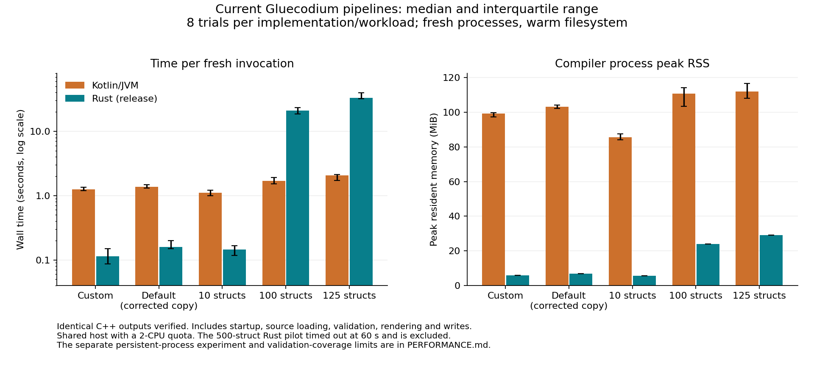

# C++ pipeline performance comparison

On these five parity-checked inputs, fresh Rust processes were faster for the two real fixtures and 10 simple structs. At 100 and 125 structs the JVM was faster. Rust used less peak resident memory on every completed workload. This is a bounded experiment on a shared host and does not establish complete compiler parity or a general language benchmark.

[Vector chart](tools/performance/results/comparison.svg).

## Fresh process, warm filesystem

Each row summarizes eight separately launched processes per implementation, paired in a fixed-seed balanced randomized order. Each metric is **median [Q1, Q3]; min–max**. Wall and CPU are seconds; peak RSS is KiB. CPU is per-invocation user + system time. Quartiles interpolate at `(n - 1) * p`. The ratio is JVM median wall divided by Rust median wall; values above 1 favor Rust.

| Workload | Implementation | Wall seconds | CPU seconds | Peak RSS KiB | JVM / Rust wall |
|---|---|---:|---:|---:|---:|
| custom | jvm | 1.248 [1.200, 1.350]; 1.143–1.747 | 1.362 [1.326, 1.388]; 1.268–1.529 | 101694 [99671, 102058]; 94216–102804 | 11.005 |
| custom | rust | 0.113 [0.086, 0.149]; 0.061–0.164 | 0.064 [0.061, 0.078]; 0.061–0.092 | 6006 [5980, 6032]; 5980–6040 | 11.005 |
| default-normalized | jvm | 1.374 [1.308, 1.474]; 1.248–1.777 | 1.434 [1.402, 1.469]; 1.300–1.614 | 105686 [104538, 106632]; 98836–109340 | 8.603 |
| default-normalized | rust | 0.160 [0.149, 0.199]; 0.104–0.224 | 0.130 [0.101, 0.143]; 0.097–0.148 | 7052 [6968, 7055]; 6940–7064 | 8.603 |
| structs-10 | jvm | 1.106 [0.996, 1.207]; 0.966–1.317 | 1.183 [1.115, 1.272]; 1.090–1.307 | 87518 [86141, 89669]; 83196–96232 | 7.623 |
| structs-10 | rust | 0.145 [0.117, 0.166]; 0.080–0.253 | 0.087 [0.083, 0.100]; 0.080–0.124 | 5674 [5669, 5697]; 5656–5724 | 7.623 |
| structs-100 | jvm | 1.686 [1.519, 1.917]; 1.465–2.811 | 1.848 [1.637, 1.958]; 1.574–2.520 | 113442 [105865, 116813]; 103392–118096 | 0.080 |
| structs-100 | rust | 21.018 [18.616, 23.251]; 16.330–23.731 | 14.808 [12.876, 18.186]; 12.786–18.556 | 24620 [24616, 24641]; 24484–24668 | 0.080 |
| structs-125 | jvm | 2.053 [1.731, 2.114]; 1.546–2.287 | 1.821 [1.732, 1.922]; 1.660–2.201 | 114774 [110702, 119500]; 108868–121592 | 0.062 |
| structs-125 | rust | 33.096 [32.120, 39.803]; 31.107–43.759 | 24.460 [24.431, 29.742]; 24.319–35.139 | 29848 [29812, 29889]; 29708–29916 | 0.062 |

The 500-struct pilot completed on the JVM in 3.027 s but the Rust process hit the predeclared 60 s limit (60.006 s, killed with signal 9). Its output was not available for comparison; no parity or speed ratio is claimed. The 125-struct intermediate was specified before the pilot and included after that timeout. Exact pilot commands, censored result, file inventories and every timed sample are in the raw artifacts.

## Inputs and output gate

| Workload | Source bytes / lines | Top-level declarations | Output files / bytes |
|---|---:|---:|---:|
| custom | 354 / 15 | 3 | 24 / 75,502 |
| default-normalized | 525 / 21 | 5 | 26 / 73,675 |
| structs-10 | 335 / 12 | 10 | 38 / 78,333 |
| structs-100 | 3,125 / 102 | 100 | 218 / 157,263 |
| structs-125 | 3,900 / 127 | 125 | 268 / 179,188 |
| structs-500 (JVM only; Rust timed out) | 15,525 / 502 | 500 | 1018 / 508,063 |

The custom workload uses the repository fixture, auxiliary input, custom namespaces, exports and copyright. The default fixture is a copy in which `field constructor(label)` is changed to `field constructor(label, mapping, tags)` so the full JVM validator accepts it; the original is unchanged. Synthetic scale workloads contain independent one-field structs and are controlled probes, not representative projects. Identical complete paths and bytes, including common files, were required before sampling. All 80 timed outputs were checked against that baseline after each timer stopped and matched. Inventories and per-file SHA-256 hashes are retained in [pilot.json](tools/performance/results/pilot.json).

## Persistent process experiment

The separate API test repeats full load, validation, generation and writing within one process per implementation using the 10-struct workload. Fixed options are parsed before the iteration timer; every iteration writes to a new directory. After 10 recorded warmup iterations, the next 10 produced the following wall times in seconds (median [Q1, Q3]; min–max):

- jvm: 0.0313 [0.0233, 0.0529]; 0.0147–0.0767
- rust: 0.1580 [0.1242, 0.1992]; 0.1229–0.2325

The JVM/Rust median ratio is 0.198: in this small persistent-process experiment the JVM was about 5.1 times faster. These iterations are correlated within one process per implementation; 10 warmups do not prove JIT steady state. They are not a subtraction of startup cost from the fresh CLI results. Per-iteration CPU and memory were not measured. The 100-struct case exceeded the preset 3-second pilot budget for repeated API measurements; 500 was excluded by the budget rule. All 40 iteration outputs matched the fresh baseline. An earlier preliminary run encountered a Java output-parent setup error and a read-only home directory that prevented JVM logging initialization. Those historical measurements and diagnostics are retained under [initial-logging-error](tools/performance/results/initial-logging-error/). For this corrected run, each JVM has a pre-created writable `-Duser.home`, and logging initialization errors invalidate the invocation.

## Method and limits

The JVM command invokes installed Gluecodium 14.2.2 through `com.here.gluecodium.Gluecodium` with `-generators cpp` and caching disabled. The native command is the rebuilt optimized `ruscodium compile-cpp`; both read LIME and write fresh full C++ output trees. Neither consumes an oracle export or pre-parsed model. Builds, fixture preparation and output hashing are outside the timers. JVM validation is broader than the native adapter’s guarded supported subset; matching generated bytes for these inputs does not equal matching every semantic obligation. Native rendering repeatedly imports the graph for generated files, which may contribute to its observed scaling; this experiment does not isolate a cause or language overhead.

Each fresh trial starts a new process and a new JVM: warmed filesystem caches do not mean warmed JVM JIT state. Linux `CLOCK_MONOTONIC` and per-child `wait4` provide wall, user/system CPU and peak RSS, with an independently launched small native supervisor. Output writes are buffered and do not include an fsync durability guarantee. Ranges reflect a small sample on a shared host, not statistical significance.

Pilot UTC: 2026-11-01T21:35:31.026722+00:00. Linux 6.18.57, Xeon Platinum 8573C, three CPUs in process affinity, cgroup quota two CPUs and 8 GiB memory limit, tmpfs output. Temurin 17.0.16+8 and rustc 1.99.1 were used. The native binary was built with `cargo build --offline --release` from the compiler source at `141fe1cd5` (identical to `12e45a188`; the intervening commit only updates planning), before the benchmark-only harness and logging-fix commits through `311528689`. Native SHA-256: `10585d3f82151cec742b7f5dacbe2b91902901e66df69b583f673f6a6ed8d697`; JVM application jar SHA-256: `fe1bda6ef33ef0abdf6c99abb3af9897b0307bb21050e107563368e7b2a8fac2`. Environment metadata and individual jar, template, binary, input and options hashes are recorded in the JSON. The original 315 production templates were retained.

Reproduction steps and the exact boundaries are in [the benchmark README](tools/performance/README.md). Raw [pilot](tools/performance/results/pilot.json), [fresh-process](tools/performance/results/fresh.json) and [persistent-process](tools/performance/results/warm.json) JSON include commands, schedule, diagnostics, samples and host metadata.
